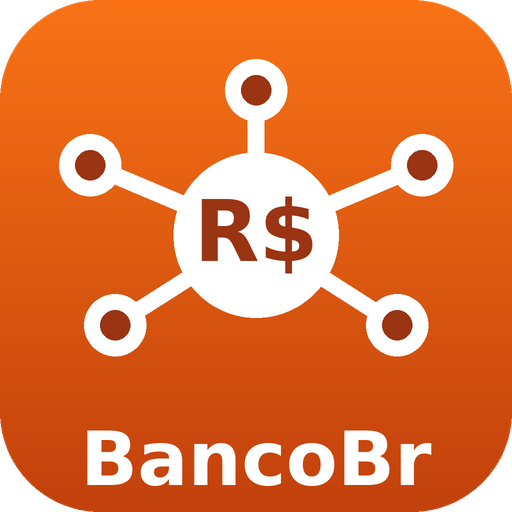

# BancoBr.NET

[](https://www.nuget.org/packages/BancoBr.API/)
[](https://www.nuget.org/packages/BancoBr.API/)
[](https://www.nuget.org/packages/BancoBr.CNAB/)
[](https://www.nuget.org/packages/BancoBr.CNAB/)

[](https://dotnet.microsoft.com/)
[](https://github.com/adrianotrentim/bancobr-net/graphs/contributors) [](https://github.com/adrianotrentim/bancobr-net/issues) [](https://github.com/adrianotrentim/bancobr-net/pulls) [](https://github.com/adrianotrentim/bancobr-net/blob/main/LICENSE)

Biblioteca para integração bancária para pagamentos de contas, transferências e PIX.

## Estatísticas do Projeto


## Instalação

Instale pelo NuGet o pacote do tipo de integração que você vai usar. O `BancoBr.Common` é instalado automaticamente como dependência.

```sh
dotnet add package BancoBr.API    # integração via API
dotnet add package BancoBr.CNAB   # integração via arquivos CNAB 240
```

## Escolha o tipo de integração

> Clique em uma das seções abaixo para ver os bancos suportados e os exemplos de uso.

<details>
<summary><h3>🔌 Integração via API</h3></summary>

### Instituições

- [x] Sicoob
- [x] Santander
- [x] [Sicredi](src/BancoBr.API/Sicredi/README.md)
- [x] [Banco do Brasil](src/BancoBr.API/BancoDoBrasil/README.md)
- [ ] Itaú
- [ ] Bradesco
- [ ] CEF

### Conectando

```csharp
using BancoBr.API;
using BancoBr.API.Base.Models;
using BancoBr.API.Core.Http;
using BancoBr.Common.Enums;
using BancoBr.Common.Instances;

var certificado = CertificateSource.FromPfxFile("caminho/para/certificado.pfx", "senhaDoCertificado");

// A conta pagadora (Correntista) é informada uma única vez na ConfiguracaoAPI e usada como origem
// em todas as operações (pagamento, consulta, cancelamento, DDA, extrato, workspace).
var correntista = new Correntista
{
    Banco = (int)BancoEnum.Sicoob,
    NumeroAgencia = 4321,
    NumeroConta = 12345,
    TipoPessoa = TipoInscricaoCPFCNPJEnum.CNPJ,
    CPF_CNPJ = "12.345.678/0001-00"
};

// Fluxo padrão: OAuth2 client_credentials, renovado automaticamente por baixo.
var banco = BancoApi.Conectar(new ConfiguracaoAPI { ClientId = "seu-client-id", ClientSecret = "seu-client-secret", CertificadoDigital = certificado, Correntista = correntista });

// Alternativa: token já emitido (ex.: portal de sandbox do Sicoob), pulando o fluxo OAuth2.
// var banco = BancoApi.Conectar(new ConfiguracaoAPI { ClientId = "seu-client-id", CertificadoDigital = certificado, Correntista = correntista }, new StaticAccessTokenProvider("token-bearer"));

// Santander (Pix, pagamento de boletos e convênios, TED, DDA): mesmo fluxo, com certificado mTLS + OAuth2. As chamadas do Hub de Pagamentos
// acontecem dentro de uma "workspace". Ela é obtida uma única vez, num endpoint separado, que acha a workspace ativa que contém a conta
// pagadora (ou cria uma) e liga nela Pix, boleto, DDA, convênio e TED. Guarde o id e informe-o em Conectar (ConfiguracaoAPI.IdWorkspace, opcional): as
// operações de pagamento, efetivação e consulta o usam direto, sem consultar as workspaces do banco a cada instância da API.
// var banco = BancoApi.Conectar(new ConfiguracaoAPI { ClientId = "seu-client-id", ClientSecret = "seu-client-secret", CertificadoDigital = certificado, Correntista = correntista });
// var idWorkspace = await banco.ObterOuCriarWorkspaceAsync(); // guarde este id
// var bancoComWorkspace = BancoApi.Conectar(new ConfiguracaoAPI { ClientId = "seu-client-id", ClientSecret = "seu-client-secret", CertificadoDigital = certificado, Correntista = correntista, IdWorkspace = idWorkspace });
```

### Pagando um boleto (consulta prévia + pagamento)

```csharp
using BancoBr.Common.Enums;
using BancoBr.Common.Instances;

var movimento = new Movimento
{
    TipoLancamento = TipoLancamentoEnum.PagamentoTituloOutroBanco,
    MovimentoItem = new MovimentoItemPagamentoTituloCodigoBarra { CodigoBarras = "00190500954014481606906809350314337370000000100" }
};

// Consulta prévia: preenche o boleto (valor, vencimento, beneficiário) e o IdentificadorConsulta.
await banco.ConsultarAgendamentoAsync(movimento);

var item = (MovimentoItemPagamentoTituloCodigoBarra)movimento.MovimentoItem;
Console.WriteLine($"Beneficiário: {movimento.Favorecido?.Nome}, Valor: {item.ValorCodigoBarra:C}");

// Envio: como a consulta prévia já deixou IdentificadorConsulta preenchido, paga direto com esses
// dados (sem consultar de novo).
await banco.EnviarAgendamentoAsync(movimento, idempotencyKey: Guid.NewGuid().ToString());

Console.WriteLine($"Situação={movimento.Situacao}, IdPagamento={movimento.NumeroDocumentoNoBanco}");
```

### Pix (transferência por chave)

```csharp
var movimentoPix = new Movimento
{
    TipoLancamento = TipoLancamentoEnum.PIXTransferencia,
    ValorPagamento = 150.00m,
    MovimentoItem = new MovimentoItemTransferenciaPIX
    {
        TipoChavePIX = FormaIniciacaoEnum.PIX_Email,
        ChavePIX = "fornecedor@dominio.com.br"
    }
};

// EnviarAgendamentoAsync já inicia e confirma o pagamento numa única chamada.
await banco.EnviarAgendamentoAsync(movimentoPix);

Console.WriteLine($"Situação={movimentoPix.Situacao}, EndToEndId={movimentoPix.NumeroDocumentoNoBanco}");

// Santander e Sicredi: mesma chamada para obter o PDF, com o download resolvido pela biblioteca.
// Se o pagamento ou o arquivo ainda não estiver pronto, retorna false: consulte novamente mais tarde.
bool obtido = await banco.ConsultarComprovanteAsync(movimentoPix);
if (obtido)
    System.IO.File.WriteAllBytes("comprovante.pdf", movimentoPix.ArquivoComprovantePDF);
// O PDF é preenchido em movimentoPix.ArquivoComprovantePDF.
```

**Migração de comprovantes:** `ConsultarComprovanteAsync` passa de `Task<Movimento>` para `Task<bool>`, indicando se o arquivo foi obtido. Os campos `LinkComprovanteBancoBr` e `ValidadeLinkComprovanteBancoBr` são substituídos por `ArquivoComprovantePDF` (`byte[]`). Atualize chamadas e persistência que utilizavam o link; na serialização JSON com Newtonsoft.Json, os bytes são representados em Base64.

O método separado `BaixarComprovanteAsync` foi removido. No Santander, obtenção do link temporário e download passam a ser internos. Nos dois bancos, `true` indica PDF preenchido em `ArquivoComprovantePDF`, e `false` indica que ele ainda não está disponível. Falhas de comunicação e cancelamento continuam propagando exceções.

### TED

```csharp
var movimentoTed = new Movimento
{
    TipoLancamento = TipoLancamentoEnum.TEDOutraTitularidade,
    ValorPagamento = 2500.65m,
    Favorecido = new Favorecido
    {
        TipoPessoa = TipoInscricaoCPFCNPJEnum.CPF,
        CPF_CNPJ = "123.456.789-00",
        Nome = "Fornecedor A"
    },
    MovimentoItem = new MovimentoItemTransferenciaTED
    {
        CodigoFinalidadeTED = FinalidadeTEDEnum.CreditoEmConta,
        Banco = 341,
        NumeroAgencia = 528,
        DVAgencia = "0",
        NumeroConta = 54321,
        DVConta = "8"
    }
};

await banco.EnviarAgendamentoAsync(movimentoTed);
await banco.ConsultarAgendamentoAsync(movimentoTed); // situação/comprovante
// await banco.CancelarAgendamentoAsync(movimentoTed); // enquanto agendada (só Sicoob; o Santander não tem cancelamento de TED)
```

### Consultando o DDA (boletos a pagar)

```csharp
var boletosDda = await banco.ConsultarDDAAsync(
    numeroConta: 12345,
    dataInicial: DateTime.Today,
    dataFinal: DateTime.Today.AddDays(30),
    situacao: SituacaoBoletoEnum.EmAberto,
    tipoData: TipoDataConsultaEnum.Vencimento); // no Santander usa o Correntista da ConfiguracaoAPI (agência/conta/DV); ignorado no Sicoob

foreach (var movimento in boletosDda)
{
    var dda = (MovimentoItemDDA)movimento.MovimentoItem;
    Console.WriteLine($"{dda.NomeRazaoSocialBeneficiario}: {dda.ValorBoleto:C} - vencimento {dda.DataVencimentoBoleto:d}");
}
```

### Consultando o extrato da conta corrente

```csharp
var extrato = await banco.ConsultarExtratoAsync(
    numeroContaCorrente: 12345,
    mes: 9,
    ano: 2026); // no Santander usa o Correntista da ConfiguracaoAPI (agência/conta/DV); ignorado no Sicoob

// No Sicoob, Sicredi e Banco do Brasil, o primeiro item é o saldo (o Santander não devolve saldo).
var saldo = extrato.Select(m => m.MovimentoItem).OfType<MovimentoItemExtratoSaldo>().FirstOrDefault();
if (saldo != null)
    Console.WriteLine($"Saldo atual: {saldo.SaldoAtual:C}");

foreach (var transacao in extrato.Select(m => m.MovimentoItem).OfType<MovimentoItemExtratoTransacao>())
{
    Console.WriteLine($"{transacao.Data:d} [{transacao.Tipo}] {transacao.Descricao}: {transacao.Valor:C}");
}
```

No Banco do Brasil, cada transação também preenche `DescricaoComplementarRetorno` com os códigos e descrições de histórico e sub-histórico recebidos. Veja o [mapeamento e exemplo do BB](src/BancoBr.API/BancoDoBrasil/README.md).

</details>

<details>
<summary><h3>📄 Integração via Arquivos CNAB 240</h3></summary>

- [x] Geração de remessa padrão CNAB 240
- [x] Leitura de retorno padrão CNAB 240

### Instituições

- [x] 237 - Bradesco
- [x] 341 - Itaú
- [x] 033 - Santander
- [ ] 756 - Sicoob
- [x] 748 - Sicredi
- [ ] 001 - Banco do Brasil
- [x] 104 - Caixa Econômica
- [x] 077 - Inter

### Segmentos

**Transferência através de TED e PIX**

- [x] Segmento A
- [x] Segmento B

**Pagamento de Títulos de Cobrança - Boletos**

- [x] Segmento J
- [x] Segmento J-52 - Código de Barras
- [x] Segmento J-52 - PIX QRCode

**Pagamento de Convênios (Luz, Água, Telefone...) e Tributos com Código de Barras**

- [x] Segmento O
- [ ] Segmento W

**Pagamento de Tributos sem Código de Barras**

- [ ] Segmento N
- [ ] Segmento B
- [ ] Segmento W

### Criando uma remessa

```csharp
var numeroArquivo = 1;

var correntista = new Correntista()
{
    TipoPessoa = TipoInscricaoCPFCNPJEnum.CNPJ,
    CPF_CNPJ = "12.345.678/0001-00",
    Nome = "Correntista BancoBR.Net",
    Endereco = "Rua Teste BancoBR.Net",
    NumeroEndereco = "567",
    ComplementoEndereco = "Compl. End.",
    Bairro = "Centro",
    CEP = 12345678,
    Cidade = "Ribeirão Preto",
    UF = "SP",
    Convenio = "",
    NumeroAgencia = 825,
    DVAgencia = "0",
    NumeroConta = 12345,
    DVConta = "6"
};

var movimentos = new List<Movimento>
{
    new Movimento
    {
        Favorecido = new Favorecido
        {
            TipoPessoa = TipoInscricaoCPFCNPJEnum.CPF,
            CPF_CNPJ = "123.456.789-00",
            Nome = "Fornecedor A BancoBR.Net",
            Endereco = "Rua Teste Fornecedor A BancoBR.Net",
            NumeroEndereco = "765",
            ComplementoEndereco = "Compl.Fornec. A",
            Bairro = "Bairro A",
            CEP = 7654321,
            Cidade = "São Paulo",
            UF = "SP"
        },
        TipoLancamento = TipoLancamentoEnum.TEDOutraTitularidade,
        TipoMovimento = TipoMovimentoEnum.Inclusao, //Valor Padrão, pode ser ignorado a setagem desta propriedade
        CodigoInstrucao = CodigoInstrucaoMovimentoEnum.InclusaoRegistroDetalheLiberado, //Valor Padrão, pode ser ignorado a setagem desta propriedade
        NumeroDocumento = "5637",
        DataPagamento = DateTime.Parse("2023-04-28"),
        ValorPagamento = (decimal)2500.65,
        Moeda = "BRL", //Valor Padrão, pode ser ignorado a setagem desta propriedade
        MovimentoItem = new MovimentoItemTransferenciaTED
        {
            CodigoFinalidadeTED = FinalidadeTEDEnum.CreditoEmConta,
            Banco = 341,
            NumeroAgencia = 528,
            DVAgencia = "0",
            NumeroConta = 54321,
            DVConta = "8"
        }
    },
    new Movimento
    {
        Favorecido = new Favorecido()
        {
            TipoPessoa = TipoInscricaoCPFCNPJEnum.CPF,
            CPF_CNPJ = "123.456.789-00",
            Nome = "Fornecedor B BancoBR.Net",
            Endereco = "Rua Teste Fornecedor B BancoBR.Net",
            NumeroEndereco = "765",
            ComplementoEndereco = "Compl.Fornec. B",
            Bairro = "Bairro B",
            CEP = 98765432,
            Cidade = "São Paulo",
            UF = "SP"
        },
        TipoLancamento = TipoLancamentoEnum.PIXTransferencia,
        NumeroDocumento = "6598",
        DataPagamento = DateTime.Parse("2023-04-28"),
        ValorPagamento = (decimal)1830.34,
        MovimentoItem = new MovimentoItemTransferenciaPIX
        {
            TipoChavePIX = FormaIniciacaoEnum.PIX_Email,
            ChavePIX = "nome@dominio.com.br"
        }
    }
};

var cnab = new ArquivoCNAB(BancoEnum.BradescoS, correntista, numeroArquivo, LocalDebitoEnum.DebitoContaCorrente, TipoServicoEnum.PagamentoFornecedor, movimentos);
var stringArquivo = cnab.Exportar();
File.WriteAllText(Path.Combine("C:\\Teste", $"cnab240_237.txt"), stringArquivo);
```

### Lendo um retorno

```csharp
var correntista = new Correntista()
{
    TipoPessoa = TipoInscricaoCPFCNPJEnum.CNPJ,
    CPF_CNPJ = "12.345.678/0001-00",
    Nome = "Correntista BancoBR.Net",
    Endereco = "Rua Teste BancoBR.Net",
    NumeroEndereco = "567",
    ComplementoEndereco = "Compl. End.",
    Bairro = "Centro",
    CEP = 12345678,
    Cidade = "Ribeirão Preto",
    UF = "SP",
    Convenio = "",
    NumeroAgencia = 825,
    DVAgencia = "0",
    NumeroConta = 12345,
    DVConta = "6"
};

var fileName = Path.Combine("C:\\Teste", $"cnab240_237.txt");
var linhas = File.ReadLines(fileName);

var cnabLeitura = new ArquivoCNAB(BancoEnum.BradescoS, correntista);
cnabLeitura.Importar(linhas);

foreach (var movimento in cnabLeitura.Movimentos)
{
    // ...
}
```

</details>

<details>
<summary><h3>⚙️ Para mantenedores: pacotes NuGet e integração contínua</h3></summary>

O workflow **Validar e gerar pacotes NuGet** (`.github/workflows/ci.yml`) compila a solução em Release, executa os testes locais e gera três pacotes:

| Pacote | Conteúdo |
| --- | --- |
| `BancoBr.Common` | Modelos, enums e contratos compartilhados |
| `BancoBr.API` | Integrações bancárias por API; depende de Common |
| `BancoBr.CNAB` | Geração e leitura de CNAB 240; depende de Common |

Pull requests e pushes em `main` apenas compilam, testam e geram versões de prévia (disponíveis nos artefatos da execução do GitHub Actions). Nada é publicado.

### Publicar uma nova versão no NuGet.org

1. Em **Releases → Draft a new release**, crie uma tag no formato `vX.Y.Z` (ex.: `v1.0.1`).
2. Clique em **Publish release**.

O workflow gera a versão `X.Y.Z` e, se os testes passarem, publica os três pacotes no NuGet.org via **Trusted Publishing** (sem API key armazenada). A publicação só ocorre quando a variável `PUBLISH_NUGET_ORG` está como `true` em **Settings → Secrets and variables → Actions → Variables**.

### Publicar no GitHub Packages (opcional)

Também é possível publicar no feed do GitHub Packages do proprietário do repositório, configurando as variáveis:

| Variável | Valor | Uso |
| --- | --- | --- |
| `PUBLISH_PACKAGES` | `true` | Habilita publicação por tag ou execução manual |
| `PACKAGE_VERSION_SUFFIX` | `fork` no fork; vazia no original | Distingue as versões de uma distribuição do fork |

Com o sufixo `fork`, a tag `v1.2.3` gera `1.2.3-fork`, e uma execução comum gera `1.0.0-fork.ci.NUMERO.TENTATIVA`. O sufixo aceita letras minúsculas e números, começando por letra. Para consumir esse feed, configure `https://nuget.pkg.github.com/PROPRIETARIO/index.json` como fonte NuGet, autenticando com um token pessoal com `read:packages` (veja as [instruções do GitHub Packages](https://docs.github.com/en/packages/working-with-a-github-packages-registry/working-with-the-nuget-registry)).

O console de homologação bancária não é executado pelo CI.

### Gerar localmente

```sh
dotnet restore BancoBr.sln
dotnet build BancoBr.sln --configuration Release --no-restore
dotnet test tests/BancoBr.Tests/BancoBr.Tests.csproj --configuration Release --no-build
dotnet pack src/BancoBr.Common/BancoBr.Common.csproj --configuration Release --no-build --output artifacts/packages
dotnet pack src/BancoBr.API/BancoBr.API.csproj --configuration Release --no-build --output artifacts/packages
dotnet pack src/BancoBr.CNAB/BancoBr.CNAB.csproj --configuration Release --no-build --output artifacts/packages
```

Os testes usam HTTP simulado e conteúdo CNAB gerado em memória, sem acessar os bancos.

</details>

## Dúvidas?

Abra um issue na página do projeto no GitHub ou [clique aqui](https://github.com/adrianotrentim/bancobr-net/issues).
